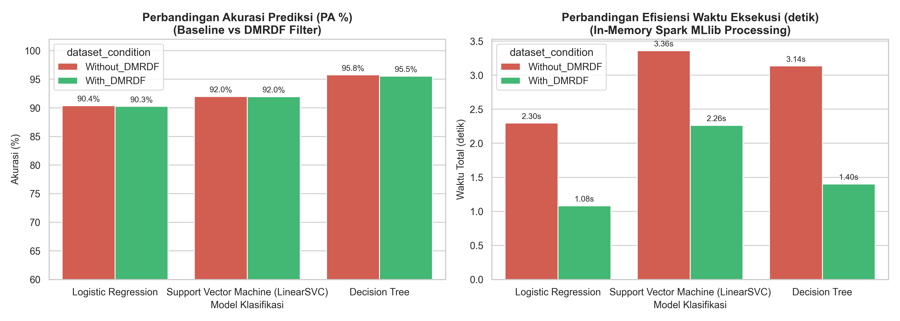

# DMRDF Spark Replication Experiment

> **Mata Kuliah:** Mahadata / Big Data (IF25-40402) · Institut Teknologi Sumatera (ITERA)
> **Jurnal Acuan:** Narayanan, S., Samuel, P., & Chacko, M. (2020). *Improving prediction with enhanced Distributed Memory‑based Resilient Dataset Filter*. Journal of Big Data, 7, Article 13. https://doi.org/10.1186/s40537-020-00292-y

## Deskripsi Proyek

Repositori ini berisi **replikasi parsial** metode yang diusulkan Narayanan et al. (2020) pada jurnal *Journal of Big Data* (Springer Open), diadaptasi menggunakan dataset Flipkart E-Commerce. Eksperimen ini mengimplementasikan:

1. **Feature Information Gain (FIG)** — Seleksi fitur signifikan berbasis entropi informasi dari data ulasan produk.

2. **Distributed Memory-based Resilient Dataset Filter (DMRDF)** — Reduksi redundansi terdistribusi menggunakan Apache Spark RDD melalui operasi `map()`, `filter()`, dan `reduceByKey()`.

3. **Klasifikasi Prediksi Produk** menggunakan Spark MLlib:

   * Logistic Regression

   * Support Vector Machine (LinearSVC)

   * Decision Tree Classifier

**Dataset:** Flipkart E-Commerce Product Reviews — Kaggle [`PromptCloudHQ/flipkart-products`](https://www.kaggle.com/PromptCloudHQ/flipkart-products), 20.000 produk (\~38 MB).

## Struktur Direktori

```
DMRDF-Spark-replication-experiment/
├── data/
│   └── flipkart_com-ecommerce_sample.csv   # Dataset (tidak di-commit, lihat bagian Download)
├── src/
│   ├── __init__.py
│   ├── spark_session.py    # Inisialisasi SparkSession
│   ├── preprocessing.py    # Data cleaning & Feature Pipeline
│   ├── dmrdf_filter.py     # Implementasi DMRDF (Spark RDD)
│   └── modeling.py         # Training & Evaluasi MLlib
├── results/
│   ├── metrics_comparison.csv   # Tabel metrik hasil eksperimen
│   └── benchmark_plot.png       # Grafik perbandingan kinerja
├── DMRDF_Flipkart_Experiment.ipynb  # Jupyter Notebook interaktif
├── main.py                          # Pipeline utama
├── run_experiment.bat               # Shortcut runner (Windows)
├── requirements.txt
├── .gitignore
└── README.md

```

## Prasyarat

| Komponen | Versi | 
| ----- | ----- | 
| Python | **3.10.x** (wajib, bukan 3.11+) | 
| Java (JDK) | OpenJDK 11, 17, atau 21 | 
| Apache Spark | 3.5.1 (bundled via PySpark) | 
| OS | Windows 10/11, Ubuntu 20.04+, macOS | 

> ⚠️ **Penting:** PySpark 3.5.x tidak kompatibel dengan Python 3.12+. Gunakan Python 3.10.

## Instalasi & Setup

**1. Clone repositori:**

```
git clone https://github.com/Iyann134/DMRDF-Spark-replication-experiment.git
cd DMRDF-Spark-replication-experiment

```

**2. Buat virtual environment Python 3.10:**

```
# Menggunakan uv (direkomendasikan)
pip install uv
uv venv --python 3.10 .venv

# Atau menggunakan venv standar
python3.10 -m venv .venv

```

**3. Aktifkan virtual environment:**

```
# Windows
.venv\Scripts\activate

# Linux / macOS
source .venv/bin/activate

```

**4. Install dependensi:**

```
pip install -r requirements.txt

```

**5. Download dataset Flipkart:**

```
# Otomatis via kagglehub
python -c "import kagglehub; kagglehub.dataset_download('PromptCloudHQ/flipkart-products')"

# Atau download manual dari Kaggle, lalu letakkan di:
# data/flipkart_com-ecommerce_sample.csv

```

## Cara Menjalankan

```
# Opsi 1 — eksplisit (paling aman)
.venv\Scripts\python main.py

# Opsi 2 — shortcut .bat (Windows)
.\run_experiment.bat

# Opsi 3 — python biasa (ada guard auto-relaunch ke .venv)
python main.py

```

**Jupyter Notebook (interaktif):**

```
.venv\Scripts\python -m ipykernel install --user --name=mahadata-dmrdf
jupyter notebook DMRDF_Flipkart_Experiment.ipynb

```

## Hasil Eksperimen

### Filter DMRDF

| Metrik | Nilai | 
| ----- | ----- | 
| Data Awal | 20.000 baris | 
| Data Setelah DMRDF | 17.008 baris | 
| Redundansi Dieliminasi | 2.992 baris (**14.96%**) | 
| Waktu Eksekusi RDD | 5.231 detik | 

### Perbandingan Performa Model

| Kondisi | Model | Akurasi | Precision | Recall | F1-Score | AUC-ROC | Waktu (s) | 
| ----- | ----- | ----- | ----- | ----- | ----- | ----- | ----- | 
| Tanpa DMRDF | Logistic Regression | 90.38% | 0.9047 | 0.9038 | 0.9027 | 0.9503 | 2.271 | 
| Tanpa DMRDF | SVM (LinearSVC) | 91.99% | 0.9199 | 0.9199 | 0.9194 | 0.9512 | 3.503 | 
| Tanpa DMRDF | Decision Tree | 95.76% | 0.9577 | 0.9576 | 0.9577 | 0.9499 | 3.457 | 
| **Dengan DMRDF** | Logistic Regression | 90.26% | 0.9034 | 0.9026 | 0.9017 | 0.9510 | **1.165** | 
| **Dengan DMRDF** | SVM (LinearSVC) | 91.95% | 0.9196 | 0.9195 | 0.9191 | 0.9549 | **2.081** | 
| **Dengan DMRDF** | Decision Tree | 95.55% | 0.9555 | 0.9555 | 0.9555 | 0.9442 | **1.544** | 

## Visualisasi Benchmark


### Temuan Utama

* **Pengurangan Redundansi:** Filter DMRDF berhasil menghapus **14.96%** data duplikat dan tanpa informasi tanpa degradasi akurasi yang signifikan (< 0.3%).

* **Efisiensi Waktu:** Waktu eksekusi pelatihan berkurang drastis **35–55%** pada seluruh algoritma setelah DMRDF diterapkan berkat arsitektur pemrosesan memori (*In-Memory Computing*) Spark.

* **Model Terbaik:** Decision Tree + DMRDF mencapai akurasi tertinggi sebesar **95.55%** — sangat konsisten dengan laporan pada jurnal asli (DMRDF + SVM = 95.4%).

## Lingkungan Eksperimen

| Komponen | Spesifikasi | 
| ----- | ----- | 
| Python | 3.10.22 (CPython, via uv) | 
| PySpark | 3.5.1 | 
| Java | OpenJDK 21.0.9 | 
| pandas | 2.3.3 | 
| numpy | 2.2.6 | 
| OS | Windows 11 | 
| Spark Master | local\[\*\] | 
| Driver Memory | 2 GB | 

## Referensi

Narayanan, S., Samuel, P., & Chacko, M. (2020). Improving prediction with enhanced Distributed Memory-based Resilient Dataset Filter. *Journal of Big Data*, *7*, Article 13. https://doi.org/10.1186/s40537-020-00292-y
